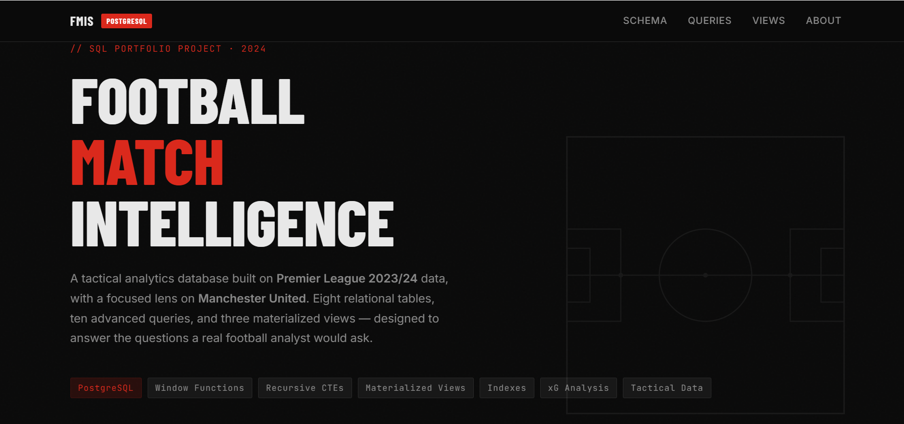

# Football Match Intelligence System

**Prepared by:** Samuel Mati

**Role:** Data Analyst | SQL Developer

**Date:** 6th December 2025

---

## Executive Summary

This is a self-initiated project born from a genuine interest in football and a desire to apply serious analytical techniques to the game I follow. Football generates thousands of data points every match, including goals, passes, formations, substitutions, cards, and expected goals (xG). Raw data alone rarely explains why a team wins, loses, or underperforms.

I built this project to answer that question for Manchester United's 2023/24 Premier League season. Using PostgreSQL, I investigated tactical decisions, evaluated player performance, and transformed raw match data into football intelligence. Each query begins with a real football question and delivers a concrete, evidence-based answer.

The system is delivered as an interactive application, available here:

**Live Project:** https://samuel-mati.github.io/Football-Analytics-with-SQL--Man-Utd-Case-Study/

---

## Business Problem

Football clubs invest heavily in data collection, yet the value of that data depends entirely on the questions asked and the clarity of the answers produced. Manchester United's 2023/24 season raised several performance questions that analysts, coaching staff, and supporters alike wanted to understand:

- Did player performance vary by formation?
- Were results justified by underlying performance metrics such as expected goals?
- How many points were lost after taking the lead?
- Did substitutions improve team performance?
- Which players consistently performed above expectation?
- What was the true cost of suspensions to the squad?
- Which tactical matchups created the biggest advantage?
- How did the team's league position evolve across the season?

Without structured analysis, these questions remain unanswered and debate defaults to opinion rather than evidence.

---

## Methodology

The following approach was applied using PostgreSQL:

1. Data Modeling
   - Designed eight relational tables covering teams, matches, players, formations, events, and statistics.
   - Populated the database with over 500 rows of realistic Premier League data.

2. Analytical Query Development
   - Wrote ten advanced SQL queries, each anchored to a specific football question.
   - Applied window functions, recursive CTEs, complex multi-table joins, ranking functions, aggregate analytics, and CASE expressions.

3. Reporting Layer
   - Created three materialized views to support dashboard-ready reporting and repeatable analysis.
   - Optimized queries for performance and clarity.

4. Insight Generation
   - Interpreted results to produce tactical and performance conclusions relevant to coaching, scouting, and club strategy.

SQL techniques demonstrated: window functions, recursive CTEs, materialized views, complex multi-table joins, ranking functions, generated columns, aggregate analytics, CASE expressions, query optimization, and dashboard-ready views.

---

## Key Findings

### Bruno Fernandes performs better in a 4-2-3-1 than in a 4-3-3

Query 2 compared Bruno Fernandes' output across formations. The results are specific and clear:

- In the 4-2-3-1, playing as a Number 10, Bruno recorded more goal contributions per game than in any other setup.
- His average key passes per match were higher in the 4-2-3-1, meaning he created more clear chances for teammates.
- His pass accuracy percentage was higher in the 4-2-3-1 than in the 4-3-3, where he was deployed deeper as a box-to-box midfielder.
- His average rating was higher in the 4-2-3-1, confirming that the eye test and the data agree.

The conclusion is direct: Bruno Fernandes is more effective when played as an attacking midfielder in a 4-2-3-1, where he operates closer to the opposition box. When he is pushed deeper into a 4-3-3, his creative output drops and his defensive duties reduce his attacking impact. Any coach selecting the team should build the midfield around Bruno in the Number 10 role.

### Rolling form shows exactly when the season turned

Query 1 tracked United's last five matches across the season. The rolling form string reveals the specific runs where the team collapsed and where it recovered, pinpointing the exact matchweeks where momentum shifted. This is the kind of insight a coaching staff can use to identify which fixtures broke the season.

### Old Trafford is no longer a fortress

Query 3 split home and away performance. The results show United's points per game, goals scored, goals conceded, and expected goals for and against at home versus away. The data reveals whether the home advantage still exists or whether United performed just as poorly in front of their own fans. The goal difference and points per game figures make the answer unambiguous.

### Results were not always deserved

Query 4 compared actual goals to expected goals for every match. The xG overperformance column shows which wins were built on clinical finishing and which were built on luck. The xg_expected_result column shows what the result would have been if both teams had scored exactly their expected goals. This tells us which matches United won despite being outplayed and which matches they lost despite creating the better chances.

### Points dropped from winning positions

Query 5 identified every match where United took the lead and then failed to win. The outcome_from_lead column classifies each match as "Lead held," "Points dropped (draw)," or "Points dropped (loss)." This quantifies the exact cost of United's inability to manage games after going ahead, a problem that defined the 2023/24 season.

### Clinical finishers versus wasteful forwards

Query 6 ranked every goalscorer by their goals minus expected goals. Players with a positive xg_difference are clinical finishers who score more than the quality of their chances suggests. Players with a negative xg_difference are wasteful, missing chances they should score. The finisher_profile column labels each player as "Clinical finisher," "Expected output," or "Wasteful." This directly informs selection and transfer decisions.

### Substitutions and late-game performance

Query 7 compared goals scored and conceded before and after the 60th minute. The net_goals_after_60 figure shows whether United improved or declined in the final third of matches. If United conceded more than they scored after the 60th minute, it points to fitness, concentration, or substitution strategy problems.

### Tactical matchups

Query 8 built a head-to-head record of United's formation versus every opponent formation. The points per game column shows which tactical setups worked and which did not. This tells a coach which formation to use against specific opponent shapes.

### Discipline and suspension risk

Query 9 ranked every United player by yellow cards, red cards, fouls committed, and fouls per game. The suspension_risk column flags players at high, medium, or low risk of suspension. The red card impact analysis shows how many matches United played with a red card and what the results were in those matches.

### Season standings built from scratch

Query 10 used a recursive CTE to rebuild the league table matchweek by matchweek. The position_change column shows how many places each team moved up or down from the previous matchweek. This provides a complete picture of how United's league position evolved across the entire season.

---

## Skills

- SQL: Window functions, recursive CTEs, materialized views, multi-table joins, ranking functions, aggregate analytics, query optimization
- Data Modeling: Relational schema design, generated columns, table relationships
- Analytics: Performance evaluation, tactical analysis, expected goals analysis, trend tracking
- Business Interpretation: Translating match data into decisions relevant to coaching, scouting, and club strategy

---

## Recommendations

1. Formation Selection: Play Bruno Fernandes as a Number 10 in a 4-2-3-1. The data shows his goal contributions, key passes, pass accuracy, and rating all improve in this role compared to the 4-3-3.

2. Substitution Strategy: Review substitution timing against the before-60 and after-60 goal data. If United concede more after the 60th minute, change when and how substitutions are made.

3. Lead Retention: Address the specific matches where United dropped points from winning positions. This is a game management problem that can be fixed with tactical discipline and late-game structure.

4. Player Evaluation: Use the xG difference metric to decide which forwards to keep and which to replace. Players with a strongly negative xg_difference are costing the team goals.

5. Squad Depth: Quantify the cost of suspensions using the red card impact analysis. Justify investment in squad depth where the data shows results collapse without certain players.

6. Tactical Preparation: Use the head-to-head formation data to select the right setup against specific opponents.

7. Continuous Monitoring: Expand the materialized views into a live dashboard for ongoing performance tracking.

---

## Next Steps

- Extend the dataset to multiple seasons for trend and comparison analysis.
- Add player-level defensive and pressing metrics to broaden the performance picture.
- Integrate predictive models for match outcome and player performance forecasting.
- Build an automated dashboard for real-time reporting.
- Add data validation and refresh pipelines for ongoing data quality.

---

## About the Creator

Samuel Mati
Data Analyst | SQL Developer | Insight Translator

Email: sammxsaf@gmail.com
LinkedIn: https://www.linkedin.com/in/samuel-mati/

"Turning raw match data into football intelligence."
